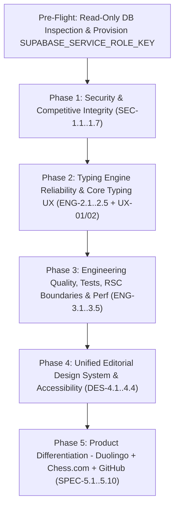

# TyProX Master Remediation & Product Development Roadmap

**Document Status:** Phases 1-4 Application Engineering & Phase 5 Verification Complete; Production SQL Migrations Prepared & Gated for Owner Approval (See [IMPLEMENTATION_STATUS.md](../../docs/roadmap/IMPLEMENTATION_STATUS.md))  
**Repository:** `c:\Users\rudra\TyProX` (`https://github.com/Rudra4451/practice`)  
**Stack Baseline:** Next.js `16.2.9` (App Router / Turbopack), React `19.2.4`, TypeScript `5` (`strict`), Tailwind CSS `v4`, Zustand `5.0.14`, Zod `4.4.3`, Supabase SSR & JS (`@supabase/ssr`, `@supabase/supabase-js`).

---

## 1. Executive Roadmap & Architectural Sequencing

TyProX possesses a promising core typing UI, deterministic PRNG text seeding, Web Worker telemetry capture, and Supabase Postgres foundation, but **critical security gaps, a `200 WPM` typing elapsed-time bug, mobile/IME input failures, 111 ESLint issues, 0 automated tests, and fragmented styling prevent launch or competitive expansion**.

Remediation and growth proceed in **five strictly sequenced phases**, decomposed into **17 small, independently verifiable implementation batches**:

### Mandatory Sequencing Rules
1. **Security before Competitive Growth:** Competitive features (ratings, 1v1 win/loss records, daily leaderboards, XP) cannot launch while client DevTools calls can post forged 350 WPM runs or mutate streaks/achievements directly.
2. **Engine Reliability before Analytics & Learning:** Personalized weak-key drills, accuracy-gated lessons, and Performance Lab heatmaps cannot produce trustworthy feedback while corrected errors vanish from accuracy or `lastKeystrokeTime` inflates speeds.
3. **Core Reliability & Lint/Test Safety Net before Visual Redesign:** Rebuilding visual surfaces on unstable auth/store state with 111 ESLint errors risks compounding layout churn and hiding runtime bugs. (Note: `UX-01`/`UX-02` typing-arena fixes pair naturally right as typing engine stabilizes, while cross-app aesthetic unification executes cleanly in Phase 4).

---

## 2. Roadmap Companion Documents

| Deliverable Document | Scope & Contents |
|---|---|
| [SECURITY_REMEDIATION_PLAN.md](../../docs/roadmap/SECURITY_REMEDIATION_PLAN.md) | Phase 1 specs (`SEC-1.1`..`SEC-1.7`), Local vs Snapshot vs Production DB model, `SUPABASE_SERVICE_ROLE_KEY` admin architecture, full hardened RLS matrix, read-only SQL pre-flight checks |
| [TECHNICAL_IMPLEMENTATION_PLAN.md](../../docs/roadmap/TECHNICAL_IMPLEMENTATION_PLAN.md) | Phase 2 math proofs & worked test cases (`ENG-2.1`..`2.5`) + Phase 3 ESLint/RSC/performance/repo hygiene specs (`ENG-3.1`..`3.5`) |
| [DESIGN_SYSTEM_PLAN.md](../../docs/roadmap/DESIGN_SYSTEM_PLAN.md) | Phase 4 `#FF5C00` + Charcoal/Light editorial token system (`DES-4.1`..`4.4`), WCAG AA fixes, active typing zero-jump spec, Bauhaus/indigo cleanup, accessible ARIA dialogs |
| [PRODUCT_FEATURE_SPECIFICATIONS.md](../../docs/roadmap/PRODUCT_FEATURE_SPECIFICATIONS.md) | Phase 5 Duolingo learning paths (`SPEC-5.1`..`5.4`), Chess.com ratings/duels (`5.5`..`5.7`), GitHub heatmap/replays/compare (`5.8`..`5.10`) |
| [TESTING_AND_ACCEPTANCE_CRITERIA.md](../../docs/roadmap/TESTING_AND_ACCEPTANCE_CRITERIA.md) | Next.js 16 aligned Vitest & Playwright architecture, SQL RLS assertion transaction, phase exit gates |

---

## 3. Small, Independently Verifiable Implementation Batches

Every batch keeps diff scope small, preserves working paths, and ends in a buildable, testable state.

### Phase 1 — Security & Competitive Integrity

#### Batch 1.1: Pre-Flight Inspection, Vitest Bootstrap & Low-Risk Security Quick Wins
- **Preconditions:** Owner access to Supabase SQL Editor (`gbovkejymfeiqgverzfr` or active project) for read-only inspection queries.
- **Scope:** Execute read-only production inspection queries (`SECURITY_REMEDIATION_PLAN.md` Section 4), bootstrap Vitest (`ENG-3.5` unit core), delete `/api/debug/supabase` & `/api/test-supabase` (`SEC-1.1`), fix `/auth/callback` Open Redirect (`SEC-1.2`), strip `?demo=true` / `typrox_demo` auth & API bypasses (`SEC-1.3`).
- **Expected Changes:**
  - Deleted `app/api/debug/supabase/route.ts`, `app/api/test-supabase/route.ts`.
  - New `lib/security/redirect.ts` + updated `app/auth/callback/route.ts`, `app/login/page.tsx`.
  - Cleaned demo branches from `lib/supabase/middleware.ts`, `app/api/leaderboard/route.ts`, `components/navbar.tsx`, `app/dashboard/*`, `app/leaderboard/page.tsx`, `components/typing/typing-container.tsx`.
  - `vitest.config.mts` + `__tests__/security/redirect.test.ts` + `__tests__/api/leaderboard.route.test.ts` (initial checks).
- **Regression Risks:** Low. Any local developer workflow relying on `?demo=true` must instead use an actual test account in Supabase dev; confirm before removal.
- **Validation Commands:** `npx tsc --noEmit`, `npm run test:unit`, `npm run build`, curl checks against `/api/debug/supabase` (`404`), `/auth/callback?next=https://evil.com`, `/dashboard?demo=true`.
- **Rollback Considerations:** Pure Next.js code changes cleanly revertible via `git revert`; zero DDL changes applied yet.

#### Batch 1.2: Shared Isomorphic Engine Math, Server Score Verifier & Hardened `POST /api/results`
- **Preconditions:** Batch 1.1 complete; **Owner provisions `SUPABASE_SERVICE_ROLE_KEY`** in `.env.local` and Vercel/host env; shared alignment decision on `generateText` (`quotes`/`code` v2 adjustments paired cleanly with client worker!).
- **Scope:** `SEC-1.4` + core `ENG-2.1` + `ENG-2.3` (shared generator/metrics/verifier so client displays exact same WPM/Accuracy/Duration server verifies!), `SEC-1.7` (Zod bounds, rate limit cooldown, error masking).
- **Expected Changes:**
  - New `lib/supabase/admin.ts`, `lib/typing/text-generator.ts`, `lib/typing/metrics.ts`, `lib/typing/verifier.ts`, `lib/security/rate-limit.ts`.
  - Updated `workers/analytics.worker.ts`, `stores/typing-store.ts`, `stores/user-store.ts` (`GuestResult` telemetry retention), `app/api/results/route.ts`, `app/api/results/sync/route.ts`, `app/dashboard/page.tsx` (`handleSyncHistory` moved off direct Supabase SDK insert), `app/api/leaderboard/route.ts` (Zod validation + masked errors).
  - Unit tests: `metrics.test.ts`, `text-generator.test.ts`, `verifier.test.ts`, `results.route.test.ts`.
- **Regression Risks:** Medium. Changing `quotes`/`code` generation logic alters text produced for any seed compared to pre-Batch-1.2 runs; mitigate by recording `generator_version = 2` (or landing SQL column in Batch 1.3 cleanly with nullable fallback). Also legacy guest runs in `localStorage` lacking `telemetry` cannot verify via ranked sync (must inform user cleanly).
- **Validation Commands:** `npx tsc --noEmit`, `npm run test:unit`, `npm run build`, manual typing run verifying submitted telemetry matches DB row & Day-1 streak becomes `1`.
- **Rollback Considerations:** Route handler still writes compatibly to existing columns before Batch 1.3 RLS lockdown (`client_run_id`/`generator_version` nullable or sequenced into Batch 1.3).

#### Batch 1.3: Validated Challenge/Profile APIs & Database RLS Hardening Migration
- **Preconditions:** Batch 1.1 read-only production SQL inspection reviewed & approved; `__debug_test__` and suspicious outlier rows audited/cleaned; Batch 1.2 live so client no longer calls browser-SDK inserts for results or challenges.
- **Scope:** `SEC-1.5` (RLS + `GRANT ALL` revocation + `leaderboard_view` `security_invoker` + `handle_new_user()` search_path/collision fix + SQL migration reconciliation), `SEC-1.6` (`POST /api/challenges`, `PATCH /api/profile` Zod + `UsernameModal` API route).
- **Expected Changes:**
  - New `app/api/challenges/route.ts`, updated `app/api/profile/route.ts`, `components/typing/result-screen.tsx` (`handleShare`), `components/auth/username-modal.tsx`, `app/challenge/[id]/page.tsx` (`expires_at` filter), `components/navbar.tsx` (`getUser()` replacing `getSession()`).
  - New migration `supabase/migrations/20260621000000_security_hardening_reconcile.sql`.
- **Regression Risks:** High if executed out of order! Dropping client `INSERT` policies on `test_results` / `challenge_links` before deploying `POST /api/challenges` and updated `ResultScreen` / `handleSyncHistory` would fail saves. Running read-only check queries in Section 4 prevents surprise policy-name collisions during DDL drop/create.
- **Validation Commands:** Apply migration in staging/local Supabase first -> run SQL RLS test transaction (`TESTING_AND_ACCEPTANCE_CRITERIA.md` Section 3) -> smoke test signup/OAuth handle edge cases, typing save, challenge share, and leaderboard load.
- **Rollback Considerations:** Keep reverse-grant backup SQL (`GRANT ...` / temporary policy restore script) ready derived from the Batch 1.1 pre-flight `pg_policies` inspection output!

---

### Phase 2 — Typing Engine Reliability & Core Typing UX

#### Batch 2.1: Drift-Free Timer, Input/IME Mobile Capture & Typing Arena Zero-Jump HUD
- **Preconditions:** Batch 1.2 & 1.3 merged and passing.
- **Scope:** `ENG-2.2` (deadline timer, error recovery, remove dead `pauseTest`/`resumeTest`, Zod URL params), `ENG-2.4` (`beforeinput` / `composition` / Android Gboard Backspace + interactive control focus isolation), plus early high-priority practice UX stability `DES-4.2` (`UX-01` keep live timer/WPM visible without layout jump + `UX-02` remove `+4` word blur!).
- **Expected Changes:**
  - Updated `stores/typing-store.ts`, `app/typing/page.tsx`, `components/typing/typing-container.tsx`, `components/typing/text-display.tsx`.
  - Tests: `typing-store.test.ts`, `typing-container.test.tsx`, `text-display.test.tsx`.
- **Regression Risks:** Medium-High on keystroke input across OS/browser/IME combinations (`onKeyDown` vs `onBeforeInput` double-delete guard must be rigorously verified on desktop Chrome/Firefox, iOS Safari, and Android Gboard!).
- **Validation Commands:** `npx tsc --noEmit`, `npm run test:unit`, `npm run build`, mobile emulation Playwright run (`typing-arena.spec.ts`).
- **Rollback Considerations:** Input handler isolated cleanly inside `TypingContainer` + `useTypingStore`; independently revertible without DB changes.

#### Batch 2.2: Result Idempotency, Real Personal Best, Challenge Submission & Cat Companion Fix
- **Preconditions:** Batch 2.1 complete.
- **Scope:** `ENG-2.5` (`ResultScreen` single-submit `clientRunId` guard, real `(mode, duration)` prior PB check, consolidated mistake breakdown, dynamic `prefers-reduced-motion` confetti cleanup, Challenge completion DB save + seed unmount cleanup, `CatCompanion` `localStorage` fix + `streakDays` prop).
- **Expected Changes:**
  - Updated `components/typing/result-screen.tsx`, `app/challenge/[id]/page.tsx`, `components/typing/cat-companion.tsx`, `app/api/results/route.ts` (return `previousBestWpm` / `isPersonalBest` + `currentStreak`).
  - Tests: `result-screen.test.tsx`, `cat-companion.test.tsx`.
- **Regression Risks:** Low-Medium (ensure confetti dynamic import works cleanly in Next Turbopack production build).
- **Validation Commands:** `npm run test:unit`, `npm run build`, strict-mode double submission test & challenge completion DB save check.
- **Rollback Considerations:** Client-side state/component changes cleanly revertible.

---

### Phase 3 — Engineering Quality, Architecture & Performance

#### Batch 3.1: Static Hygiene, Generated DB Types & Zero ESLint Failures
- **Preconditions:** Batch 2.2 complete.
- **Scope:** `ENG-3.1` (generate `types/database.ts`, replace all 26 `any`s, fix all 14 `set-state-in-effect`, fix React 19 Compiler `immutability`/`purity` in `ReplayPlayer` & `CatCompanion`, fix 6 unescaped entities & 56 unused warnings, implement O(1)/checkpoint scrubbing inside `ReplayPlayer`).
- **Expected Changes:**
  - New `types/database.ts`; typed updates across `lib/**`, `stores/**`, `app/**`, `components/**`, `workers/analytics.worker.ts`.
- **Regression Risks:** Medium when refactoring `useEffect` -> `useMemo` in complex pages like `Dashboard` and `Leaderboard` (careful verification needed for async filter reloads).
- **Validation Commands:** `npx tsc --noEmit`, **`npm run lint` (must exit `0` with 0 errors and 0 warnings)**, `npm run test:unit`, `npm run build`.
- **Rollback Considerations:** Small per-file ESLint commits recommended (`replay-player`, `dashboard`, `cat-companion`, API routes) so any subtle regression isolates cleanly.

#### Batch 3.2: Repository Cleanup, Real Achievement Icons & Functional Settings (`/profile`)
- **Preconditions:** Batch 3.1 clean (`npm run lint` = 0); **Owner confirmation on `/showcase` disposition** (`remove` vs `rewrite later`).
- **Scope:** `ENG-3.2` (delete `app/page.tsx.modified`, `lib/supabase.ts`, `public/robots.txt`, unused template SVGs; add `.env.example`, fix `README.md`; add `public/achievements/*.svg`; link `/profile` cleanly & implement real selectable fonts + WebAudio click synthesizer + DB preference sync; adopt `Skeleton`).
- **Expected Changes:**
  - Deleted dead files; added `public/achievements/*.svg`, `lib/audio/keystroke-sound.ts`, `.env.example`.
  - Updated `app/layout.tsx`, `app/globals.css`, `app/profile/page.tsx`, `components/navbar.tsx`, `stores/user-store.ts`, `README.md`.
- **Regression Risks:** Low. Ensure `next/font/google` selected font families compile offline/Vercel build cleanly without missing font names (`Inter`, `Space_Grotesk`, `JetBrains_Mono`, `IBM_Plex_Mono`).
- **Validation Commands:** `npm run lint`, `npm run test:unit`, `npm run build`, verify `/robots.txt`, achievement SVGs HTTP `200`, and `/profile` preference reload persistence.
- **Rollback Considerations:** Asset/settings additions cleanly revertible; DB default `font_family` supports both old `'ibm-plex-mono'` and new `'jetbrains-mono'`.

#### Batch 3.3: Server/Client Component Boundaries, AuthProvider & Bounded Data Fetching
- **Preconditions:** Batch 3.2 complete.
- **Scope:** `ENG-3.3` (extract `<AuthProvider>` out of `Navbar`; build `server-only` DAL `lib/data/*`; migrate `/`, `/leaderboard`, `/u/[username]`, `/challenge/[id]` to React Server Components + `generateMetadata`; paginate `/dashboard`; fix unfiltered `PerformanceLabPage` Realtime channel `TD-08`).
- **Expected Changes:**
  - New `components/providers/auth-provider.tsx`, `lib/data/{leaderboard,profile,challenge,dashboard}.ts`, split client leaf components.
  - Updated `app/layout.tsx`, `app/page.tsx`, `app/leaderboard/page.tsx`, `app/u/[username]/page.tsx`, `app/challenge/[id]/page.tsx`, `app/dashboard/page.tsx`, `app/dashboard/performance-lab/page.tsx`, `components/navbar.tsx`.
- **Regression Risks:** Medium-High (`next/dynamic` vs RSC client boundary rules, cookies/session SSR vs browser client separation). Must test SSR hydration carefully to avoid hydration mismatch warnings.
- **Validation Commands:** `npx tsc --noEmit`, `npm run lint`, `npm run build`, curl inspection of SSR HTML (`curl http://localhost:3000/u/<user>` includes metadata & profile stats), verify filtered Realtime behavior.
- **Rollback Considerations:** Retain clean separation between DAL modules and page wrappers for clean revert if caching/SSR edge case arises.

#### Batch 3.4: Performance Pass, Error Boundaries, Security Headers & Full Playwright Suite
- **Preconditions:** Batch 3.3 complete.
- **Scope:** `ENG-3.4` (`Hero3D` IntersectionObserver + visibility + CSS rainbow hue zero-rerender; `TextDisplay` pure CSS spans without per-char `<motion.span>`; `Avatar` safe fallback; `app/error.tsx`, `app/global-error.tsx`, route `loading.tsx` skeletons; `next.config.ts` security headers & CSP + `optimizePackageImports`; bundle analyze diff) + `ENG-3.5` Playwright setup (`tests/e2e/*`).
- **Expected Changes:**
  - Updated `next.config.ts`, `components/home/hero-3d.tsx`, `components/typing/text-display.tsx`.
  - New `components/ui/avatar.tsx`, `app/{error,global-error}.tsx`, route `loading.tsx`, `playwright.config.ts`, `tests/e2e/*.spec.ts`.
- **Regression Risks:** Medium on **CSP header tuning**: overly strict `script-src` / `worker-src` / `connect-src` can break Next inline hydration scripts, `analytics.worker.ts`, or Supabase Realtime WSS! Ship `Content-Security-Policy-Report-Only` first or test exhaustively under Playwright with console error assertions before enforcing!
- **Validation Commands:** `npx next experimental-analyze --output`, `npm run lint`, `npm run test:unit`, `npm run build`, `npm run test:e2e`.
- **Rollback Considerations:** Security CSP toggleable between Report-Only and Enforce inside `next.config.ts`.

---

### Phase 4 — Unified Editorial Design System & UX

#### Batch 4.1: Unified `@theme` Tokens, WCAG AA Contrast & Theme Hydration Sync
- **Preconditions:** Phase 3 Playwright & Lint CI checks passing cleanly.
- **Scope:** `DES-4.1` (define `--color-warning`, `--color-surface-hover`, `--accent-foreground`, `--accent-ink`; brighten muted AA greys; retire `bauhaus-*`, indigo shadows, `neutral-850`, `bg-noise-overlay`; fix `Button` primary foreground to `#0F0F10`; sync default `'dark'` across `layout.tsx` & `useUserStore`; fix light-mode `Hero3D` vignette & `CatCompanion` surface).
- **Expected Changes:** `app/globals.css`, `app/layout.tsx`, `stores/user-store.ts`, `components/ui/button.tsx`, `components/home/hero-3d.tsx`, `components/typing/cat-companion.tsx`.
- **Regression Risks:** Low-Medium (verify no leftover routes relied implicitly on `bauhaus-*` aliases — update those cleanly or keep scoped cleanly until Batch 4.2 commits atomically alongside it!). *Tip:* Ship Batch 4.1 + 4.2 cleanly or grep all `bauhaus-` tokens before removing aliases in `globals.css`.
- **Validation Commands:** `npm run lint`, `npm run build`, `npm run test:e2e` (light + dark theme toggle + visual screenshots).
- **Rollback Considerations:** Token palette strictly CSS + component class diffs; cleanly revertible.

#### Batch 4.2: Route Surface Unification, Accessible Navigation & Honest Copy
- **Preconditions:** Batch 4.1 complete (or atomic CSS alias deprecation).
- **Scope:** `DES-4.3` (convert `/dashboard/performance-lab`, `/challenge/[id]`, `/u/[username]`, `UsernameModal`, `ToastContainer`, and Leaderboard empty state away from `border-3` Neobrutalist / Bauhaus / indigo onto clean hairline editorial surfaces; add `role="dialog"` focus trap to modals; add `Navbar` dropdown menu exposing `/dashboard`, `/u/[username]`, `/profile`; strip fake `"online"` counter & `"Demo Rankings"`; render `fingerLoads` in Performance Lab; Dashboard mobile cards) + `DES-4.4` (`Hero3D` 60-col CSS Grid keyboard math, clean `HUDPanel` layout, remove fake testimonials & unbacked XP badges).
- **Expected Changes:** `components/navbar.tsx`, `components/auth/username-modal.tsx`, `components/ui/toast-container.tsx`, `components/home/*`, `app/{page,login,leaderboard,dashboard,profile}/**`, `app/challenge/[id]/page.tsx`, `app/u/[username]/page.tsx`.
- **Regression Risks:** Medium UI regression potential across breakpoints; mitigate via full desktop (`1280px`) & mobile (`375px`) Playwright overflow + focus + interaction checks.
- **Validation Commands:** `npm run lint`, `npm run test:unit`, `npm run build`, `npm run test:e2e` (`responsive-theme.spec.ts`, `public-flows.spec.ts`).
- **Rollback Considerations:** Grouped cleanly by route group so individual component diffs remain reversible.

---

### Phase 5 — Product Differentiation (Duolingo + Chess.com + GitHub)

#### Batch 5.1: Learning Pillar Foundation — Verified Weak-Key Drills (`SPEC-5.1`) & Daily Challenges (`SPEC-5.4`)
- **Preconditions:** Phases 1–4 complete and verified.
- **Scope:** Deploy `replay-analyzer.ts`, `?mode=drill` targeted generator (`is_ranked = false`), clickable weak-key drill CTAs on Performance Lab & ResultScreen, plus wiring `daily_challenges` & `user_challenge_progress` (`/daily` + Daily Standings).
- **Expected Changes:** `lib/typing/replay-analyzer.ts`, `lib/data/daily-challenge.ts`, `app/daily/page.tsx`, `app/dashboard/performance-lab/page.tsx`, `app/api/results/route.ts`, migration adding `is_ranked` & locking `user_challenge_progress` direct inserts.
- **Regression Risks:** Ensure `drill` & non-ranked modes NEVER contaminate global speed leaderboards (`WHERE is_invalidated = false AND user_id IS NOT NULL AND is_ranked = true` on `leaderboard_view`).
- **Validation Commands:** Unit tests (`replay-analyzer.test.ts`), RLS verification on `user_challenge_progress`, Playwright `/daily` + drill launch E2E.
- **Rollback Considerations:** Forward migration adds nullable/defaulted columns cleanly without breaking prior results.

#### Batch 5.2: Progression & Curriculum — `/learn` Paths (`SPEC-5.2`) + Server XP & Streak Freezes (`SPEC-5.3`)
- **Preconditions:** Batch 5.1 verified.
- **Scope:** Implement `user_progression` (XP, Level), `streaks.freeze_tokens`, user timezone preference, structured `/learn` paths + `/learn/[slug]` accuracy-gated mastery stars (`user_lesson_progress`).
- **Expected Changes:** `constants/curriculum.ts`, `lib/progression/xp.ts`, `app/learn/**`, `app/api/results/route.ts`, `app/api/profile/route.ts`, `app/dashboard/page.tsx`, forward SQL migration.
- **Regression Risks:** Must verify `user_progression` has **zero** client update/insert policies (`service_role` only).
- **Validation Commands:** Unit tests (`xp-and-rating.test.ts`), RLS test verifying client cannot spoof XP/stars, Playwright `/learn` completion check.
- **Rollback Considerations:** Isolated `/learn` route and `user_progression` table leave core `/typing` intact on rollback.

#### Batch 5.3: Competitive Pillar — Persistent 1v1 Match Attempts (`SPEC-5.5`) & Seasonal Skill Rating (`SPEC-5.6`)
- **Preconditions:** Batch 5.2 verified.
- **Scope:** `challenge_attempts` table + `/challenge/[id]` contender board & rematch flow + `seasons` / `season_standings` verified rating ladder (`TSI`) with `5`-run placement threshold.
- **Expected Changes:** `lib/progression/rating.ts`, `app/challenge/[id]/**`, `app/api/results/route.ts`, `app/leaderboard/**`, `app/dashboard/page.tsx`, forward SQL migration.
- **Regression Risks:** Rating edge cases (abandons vs completed ranked runs, self-challenge farming); covered strictly by unit tests and SQL unique constraints.
- **Validation Commands:** `npm run test:unit`, SQL RLS checks on `challenge_attempts` & `season_standings`, Playwright duel + leaderboard tab test.
- **Rollback Considerations:** Rating calculation decoupled from `test_results` storage; seasonal ladder tab can be toggled cleanly without impacting primary WPM records.

#### Batch 5.4: Community Identity — 365-Day Heatmap Profiles (`SPEC-5.8`), Shareable Replays (`/replay/[id]`, `SPEC-5.9`)
- **Preconditions:** Batch 5.3 verified.
- **Scope:** Public `/u/[username]` GitHub-style 365-day activity heatmap, PB matrix across `(mode, duration)`, bio/keyboard gear settings, and standalone shareable `/replay/[id]` route linked from Dashboard & Public Profiles.
- **Expected Changes:** `lib/data/{profile,replay}.ts`, `app/replay/[id]/page.tsx`, `components/profile/{activity-heatmap,pb-matrix}.tsx`, `app/u/[username]/page.tsx`, `app/dashboard/page.tsx`, `app/profile/page.tsx`, SQL heatmap RPC + optional `bio`/`keyboard_setup` columns.
- **Regression Risks:** Performance of trailing 365-day SQL grouping under large history; test indexed `(user_id, created_at DESC)` plan cleanly (`EXPLAIN ANALYZE`). Verify `/replay/[id]` respects `generator_version` (`1` vs `2`) and denies `is_invalidated = true`.
- **Validation Commands:** Unit tests, Playwright `/u/[username]` & `/replay/[id]` playback E2E.
- **Rollback Considerations:** Additive profile fields and read-only view/routes.

#### Batch 5.5: Social Rivalries & Polish — Follows (`SPEC-5.7`), User Comparison (`/compare`, `SPEC-5.10`) & Expanded Achievements
- **Preconditions:** Batch 5.4 verified.
- **Scope:** `follows` table & `"Following"` Leaderboard filter, `/compare?a=u1&b=u2` delta page, expanded accuracy/versatility/duelist achievements + SVGs.
- **Expected Changes:** `app/api/follows/route.ts`, `app/compare/page.tsx`, `lib/data/compare.ts`, `app/leaderboard/**`, `app/u/[username]/page.tsx`, seed extension migration.
- **Regression Risks:** Low. Ensure `follows` rate limit + max `250` follow cap prevents graph spam.
- **Validation Commands:** Full `npm run check && npm run test:e2e` + RLS transaction check on `follows`.
- **Rollback Considerations:** Isolated `/compare` and `follows` feature slice.

---

## 4. Audit Finding Traceability, Priority & Complexity Matrix

| Roadmap Task | Audit Reference(s) | Phase / Batch | Priority | Complexity |
|---|---|---|---|---|
| `SEC-1.1` Remove debug/test APIs | `SEC-04`, `PA-09` | Phase 1 / Batch 1.1 | `Critical` | `S` |
| `SEC-1.2` Fix OAuth Callback Open Redirect | `SEC-03` | Phase 1 / Batch 1.1 | `High` | `S` |
| `SEC-1.3` Strip `?demo=true` & cookie bypasses | `SEC-05`, `TD-04` | Phase 1 / Batch 1.1 | `High` | `M` |
| `SEC-1.4` Server score verification & anti-cheat | `SEC-01`, `PA-01`, `PA-02`, `FI-02` | Phase 1 / Batch 1.2 | `Critical` | `L` |
| `SEC-1.5` Least-privilege grants, RLS & `leaderboard_view` | `SEC-02`, `SEC-06`, `SEC-08`, `TD-03` | Phase 1 / Batch 1.3 | `Critical` | `L` |
| `SEC-1.6` Verified Challenge & Profile mutation APIs | `SEC-01`, `SEC-07`, `SEC-08`, `FI-03` | Phase 1 / Batch 1.3 | `High` | `M` |
| `SEC-1.7` Leaderboard Zod, rate limit, `getUser()`, headers | `SEC-07`, `SEC-08`, `PA-05`, `PA-09` | Phase 1 / Batch 1.2 & 3.4 | `Medium` | `M` |
| `ENG-2.1` Unified metrics math (`metrics.ts`, 200 WPM fix) | `PA-01`, `PA-02`, `PA-04` | Phase 2 / Batch 1.2 & 2.1 | `Critical` | `M` |
| `ENG-2.2` `performance.now()` timer, pause policy, error recovery | `PA-03`, `TD-05` | Phase 2 / Batch 2.1 | `High` | `M` |
| `ENG-2.3` `quotes` length, `code` spacing, `createSeed()` | `PA-05` (2.5), `TD-05` | Phase 2 / Batch 1.2 & 2.1 | `High` | `S` |
| `ENG-2.4` Mobile input, IME composition, Android Backspace | `PA-08`, `UX-06` | Phase 2 / Batch 2.1 | `High` | `M` |
| `ENG-2.5` Result idempotency, real PB, challenge save, Cat fix | `PA-07`, `FI-03`, `FI-04`, `FI-05`, `TD-07`, `UX-08` | Phase 2 / Batch 2.2 | `High` | `M` |
| `ENG-3.1` Zero ESLint failures & Supabase DB types | `TD-01`, `TD-06`, `PA-06` | Phase 3 / Batch 3.1 | `High` | `L` |
| `ENG-3.2` Dead files, achievement SVGs, working `/profile` | `TD-02`, `FI-01`, `PA-09` | Phase 3 / Batch 3.2 | `Medium` | `M` |
| `ENG-3.3` RSC conversion, `AuthProvider`, pagination, Realtime | `PA-05`, `TD-08`, `SEC-06` | Phase 3 / Batch 3.3 | `Medium` | `L` |
| `ENG-3.4` `Hero3D`/DOM perf, error boundaries, bundle/headers | `PA-04`, `PA-09`, `TD-02`, `UX-06` | Phase 3 / Batch 3.4 | `Medium` | `M` |
| `ENG-3.5` Vitest & Playwright automated testing suite | `PA-06` | Phase 1–3 / Batch 1.1 & 3.4 | `Critical` | `M` |
| `DES-4.1` Unified tokens, AA contrast, theme hydration sync | `UX-03`, `UX-04`, `UX-05`, `UX-06` | Phase 4 / Batch 4.1 | `High` | `M` |
| `DES-4.2` Typing HUD zero-jump, remove blur, mobile controls | `UX-01`, `UX-02`, `UX-07`, `UX-08` | Phase 2 & 4 / Batch 2.1 & 4.2 | `Critical` | `M` |
| `DES-4.3` Unify Bauhaus/indigo routes, ARIA dialogs, nav links | `UX-03`, `UX-06`, `UX-07`, `UX-08`, `FI-06` | Phase 4 / Batch 4.2 | `High` | `L` |
| `DES-4.4` `Hero3D` 60-col Grid, honest copy (no fake proof) | `UX-03`, `UX-05`, `UX-06`, `UX-07`, `FI-05` | Phase 4 / Batch 4.2 | `Medium` | `M` |
| `SPEC-5.1`..`5.4` Learning Pillar (Drills, `/learn`, XP, `/daily`) | `FI-02`, `FI-05`, `FI-06`, Vision Pillar 1 | Phase 5 / Batch 5.1 & 5.2 | `High/Med` | `L` |
| `SPEC-5.5`..`5.7` Competition (`challenge_attempts`, TSI, `follows`) | `FI-03`, Vision Pillar 2 | Phase 5 / Batch 5.3 & 5.5 | `High/Med` | `L` |
| `SPEC-5.8`..`5.10` Community (365-day heatmap, `/replay/[id]`, `/compare`) | `FI-07`, `TD-08`, Vision Pillar 3 | Phase 5 / Batch 5.4 & 5.5 | `Medium` | `L` |

---

## 5. Risks Requiring Product Owner Approval Before Implementation

1. **Provisioning `SUPABASE_SERVICE_ROLE_KEY` & Server-Side Persistence Architecture:**
   - Removing client `INSERT`/`UPDATE` policies from Postgres (`SEC-1.5`) requires `SUPABASE_SERVICE_ROLE_KEY` in `.env.local` and deployment secrets (e.g., Vercel) so `POST /api/results`, `POST /api/challenges`, and `/api/results/sync` write via `createAdminClient()`. Alternative (`SECURITY DEFINER` SQL RPCs) is far less maintainable for deterministic TypeScript text verification. **Requires owner approval to supply/set the secret key.**
2. **Production Database Pre-Flight Inspection & Existing Dirty Data Cleanup:**
   - Because live Supabase schema state may reflect `FULL_SCHEMA.sql` rather than ordered migrations `20260618`–`20260620`, running any migration blind risks policy collisions or broken live queries. Owner approval is needed to run the read-only verification script (`SECURITY_REMEDIATION_PLAN.md` Section 4), delete existing `__debug_test__` rows, and flag/purge historical unverified outlier scores (`wpm > 250` or forged `NULL` guest leaderboard rows).
3. **Disposition of Orphaned `/showcase` (`app/showcase/page.tsx`) and Dead `pauseTest`/`resumeTest`:**
   - *Recommendation:* Delete `app/showcase/page.tsx` (1,236 lines of hardcoded mock Bauhaus tour) and remove dead `pauseTest`/`resumeTest` actions on ranked timed tests. If owner prefers keeping `/showcase` or pause support in casual practice mode, confirm before Batch 2.1 / Batch 3.2.
4. **Legacy `GuestResult` Telemetry Gap During Cloud Sync (`handleSyncHistory`):**
   - Existing `GuestResult` rows already saved in users' `localStorage` contain no `telemetry`. Once Batch 1.2/1.3 closes direct client DB insertion, those older unverified local guest entries cannot pass telemetry verification for ranked leaderboards. Confirm whether to exclude legacy telemetry-less entries from ranked leaderboard submission (allowing unranked import only or clean notice) while capturing full telemetry on all *new* guest runs going forward.
5. **External Supabase Auth / OAuth & Host Configuration Verification:**
   - Confirm Google/GitHub OAuth Redirect URI allowlist in external Supabase Dashboard (`https://.../auth/v1/callback` + production site URL) and define authoritative `NEXT_PUBLIC_SITE_URL` (`typrox.vercel.app` vs custom domain).
6. **Guest Access Policy for `/dashboard/performance-lab` & Replay Privacy:**
   - Currently `proxy.ts` excludes `/dashboard/performance-lab` from login redirect so guests see a locked teaser overlay. Confirm keeping teaser vs redirecting cleanly to `/login`, and confirm default public visibility for individual `/replay/[id]` shares vs opt-out setting in `/profile`.

